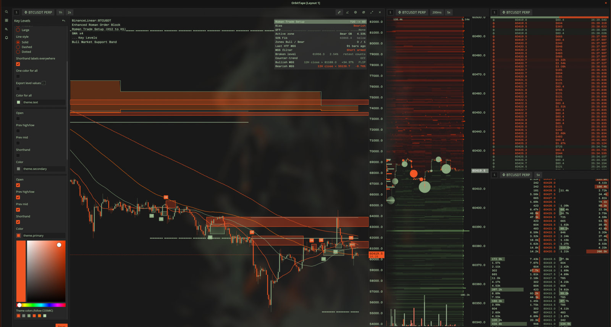
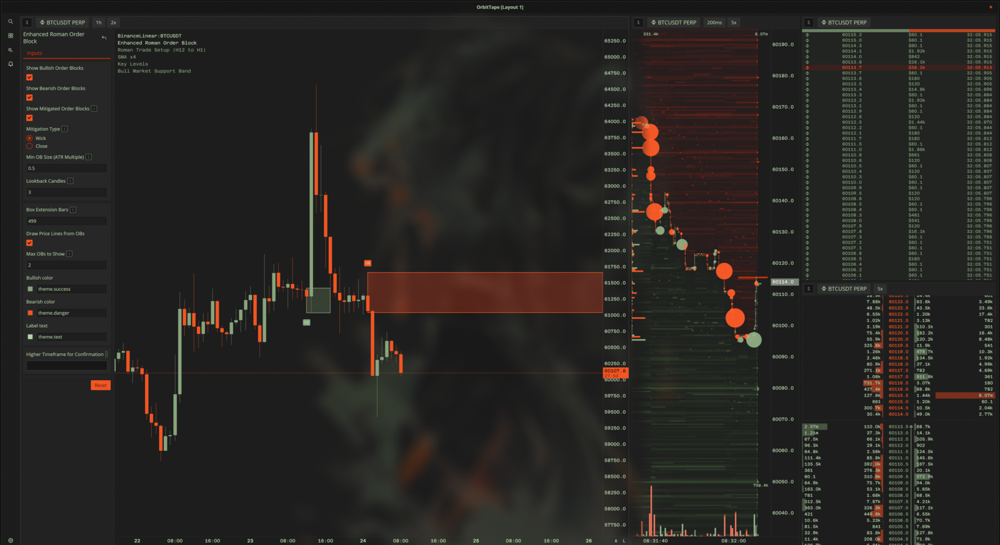
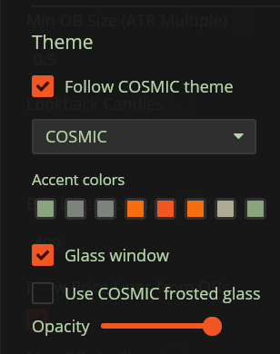

<div align="center">
  

# Orbit Tape

**Order flow on orbit - a native crypto charting desk for COSMIC**

[](https://github.com/atraxsrc/orbit-tape/actions/workflows/ci.yml)
[](LICENSE)
[](https://doc.rust-lang.org/edition-guide/rust-2024/)
[](https://github.com/iced-rs/iced)
[](https://system76.com/cosmic)
[](#install)

</div>

Orbit Tape is a native desktop charting app for crypto markets: order book
heatmaps, footprint and candlestick charts, time and sales and a DOM ladder,
streamed straight from the exchanges, with scriptable indicators and desktop
alerts. It is for discretionary traders who read order flow and want a fast,
local tool instead of a browser tab.

It runs on **Linux only** and is made for the [COSMIC](https://system76.com/cosmic)
desktop on Pop!_OS. Orbit Tape is a fork of
[Flowsurface](https://github.com/flowsurface-rs/flowsurface) and builds on its
work; see [Credits](#credits).

<div align="center">
  
  <br /><br />
  
  <br /><br />
  
</div>

## Features

- **Pane types**
    - **Time & Sales:** scrollable list of live trades, mergeable across tickers.
    - **DOM / Ladder:** the current order book next to recent traded volume on
      grouped price levels.
    - **Heatmap (historical DOM):** live trades and order book as a time-series
      heatmap, with adjustable price grouping and timeframes.
    - **Candlestick:** footprints, volume and TPO profiles, big trades, custom
      tick-based intervals and scriptable indicators. See [Studies](#studies).
- **Scriptable indicators** in a Pine-like language, with higher-timeframe data,
  Pine-style drawing and an indicator CLI. See [Custom indicators](#custom-indicators).
- **Indicator alerts:** boolean plots marked `alert = true` send a desktop
  notification and a chime when they are true on a newly closed bar
  (Settings → Alerts). At launch, charts from the saved layout also report
  a bar that closed while the app was off, if it closed at most one bar ago,
  labelled "missed while closed"; an alert delivered before a restart is
  not delivered again.
- **Price alerts:** right-click the price chart and pick "Add alert at <price>".
  The alert line fires once when the live price crosses it, then stays on the
  chart as "Alert fired" until you right-click it and re-arm it. Drag the line
  to move the alert. Right-click and "Remove alert" deletes the line; to keep
  the line, untick "Alert" in its toolbar. Any horizontal line can be turned
  into an alert from its toolbar. The same menu can remove all alerts,
  drawings, indicators or studies at once.
- **Saved alerts:** price alerts and indicator alerts (an indicator's alert
  condition on a market and timeframe, also with no chart open) are saved in
  `alerts.json`, listed under the bell in the sidebar with pause, once or
  every bar, and desktop, phone ([ntfy](https://ntfy.sh)) or both. Claude can
  create and manage them through the MCP server, on USDT perpetuals or OKX
  spot pairs. They fire while the app is
  open, and with `orbit-tape watch` also while it is closed. See
  [docs/mcp.md](docs/mcp.md#alerts).
- **Headless scan, watcher and MCP server:** `orbit-tape scan` runs an
  indicator over a coin list from a systemd timer, `orbit-tape watch` runs the
  saved alerts as a systemd user service, and `orbit-tape mcp` gives AI
  assistants market tools and alert management. See
  [Headless scan](#headless-scan) and
  [MCP server](#mcp-server-for-ai-assistants).
- **Alert history:** the bell in the sidebar lists the last 500 fired alerts
  (time, symbol, condition, price) with an unread count, kept across
  restarts in `alert-history.json`. Click an entry to focus its chart.
- **Trade sound effects** driven by the live trade stream.
- **Multi-window:** pop panes out into their own windows.
- **Pane linking:** panes in the same link group switch ticker together.
- **Saved layouts, chart presets and themes** with editable color palettes.
- **Exchanges:** Binance, Bybit, Hyperliquid, OKX and MEXC (spot and perpetuals
  where the exchange offers them).

### Market data

**Live:** trades, order book and kline updates stream from the exchanges'
WebSocket feeds.

**Historical trades:** optional backfill for the visible range on time-based
candlestick charts, set in **Settings → Network**:

- **Off:** no backfill.
- **Exchange:** fetches from Binance's public REST API and bulk data mirrors
  ([data.binance.vision](https://data.binance.vision/)). Daily archives are
  cached on disk; intraday ranges are paginated and rate-limited. **Binance
  only** (spot, linear, inverse).
- **Server:** fetches from a server exposing `GET /trades.arrow`, such as the
  upstream [`flowsurface-server`](https://github.com/flowsurface-rs/server)
  collector. Works with every supported exchange the server collects.

**Historical klines, open interest and ticker metadata** always come from the
exchanges' REST APIs.

### Studies

Footprints need **Trade data** enabled in the pane settings and enough zoom for
their columns to show.

- A pane uses one profile source, **candle-based** or **trade-based**. Studies
  of the same source can coexist (one visible-range profile, one recurring
  profile, one TPO); **Big Trades** is trade-only and independent.
- **Candle-based** studies use lower-timeframe klines (`1m` up to `2h`, `3m` up
  to `4h`, `5m` up to `12h`, `15m` above). They approximate: a candle's volume
  is spread over its range and counts as buying when `close >= open`.
- **Trade-based** studies use actual prints: more precise, but they need trade
  data and more processing.
- TPO anchors are UTC; the initial balance is the first hour of the profile.
- Big Trades filters on quote-currency notional; rings group several trades.

## COSMIC status

What is COSMIC-specific today:

- **Launcher and window integration:** the app ID `io.github.atraxsrc.OrbitTape`
  is the Wayland app_id and matches the `.desktop` entry, so COSMIC shows the
  right icon and groups the windows in the dock.
- **Original icon** in the hicolor theme, sized from 16 to 512 px.
- **Wayland-only** rendering (no X11 backend).
- **COSMIC theme** (Settings → Theme, on by default): the app reads COSMIC's
  theme files and follows its light/dark mode, accent, background, text,
  success/warning/destructive colors and corner radii live. The 8 color
  swatches for drawings, indicators and series come from the COSMIC palette
  (accent_blue, indigo, purple, pink, red, orange, yellow, green); click one
  in Settings → Theme to set any color by picker or hex instead.
- **Frosted glass:** a see-through, compositor-blurred window that follows
  COSMIC's frosted-window setting, or a hand-set opacity.
- **Desktop notifications** through the freedesktop notification service that
  COSMIC provides.

Planned:

- A port of the UI to [libcosmic](https://github.com/pop-os/libcosmic), with a
  native header bar and COSMIC widgets.
- Settings integration with COSMIC Settings.

## Install

### .deb (recommended)

1. Download `orbit-tape_<version>_amd64.deb` from the
   [latest release](https://github.com/atraxsrc/orbit-tape/releases/latest).
   Optionally check it against `SHA256SUMS` from the same release:
   `sha256sum -c SHA256SUMS --ignore-missing`.
2. Install it:

   ```sh
   sudo apt install ./orbit-tape_*_amd64.deb
   ```

3. Start **Orbit Tape** from the COSMIC launcher.

Updates are manual for now: download the new release and run the same
command. Uninstall with `sudo apt remove orbit-tape`; your settings in
`~/.local/share/orbit-tape` are kept.

The package also installs `orbit-tape-indicator`, the indicator CLI, and
copies of the Roman and market indicators in
`/usr/share/doc/orbit-tape/indicators/`. After an update, the Indicators
panel (and the MCP tools) name any copy in your own indicators folder that is
older than the shipped one, with the `cp` command that updates it; your copy
keeps running until you do.

### Build from source (Pop!_OS 26.04)

```sh
sudo apt install build-essential pkg-config libasound2-dev git curl
curl --proto '=https' --tlsv1.2 -sSf https://sh.rustup.rs | sh   # Rust via rustup

git clone https://github.com/atraxsrc/orbit-tape
cd orbit-tape
cargo build --release --locked
./target/release/orbit-tape
```

`orbit-tape --help` lists the commands (`scan`, `watch`, `mcp`, `report`) and
options, and `orbit-tape --version` prints the version. Each command has its
own `--help`.

`rust-toolchain.toml` pins the Rust version; rustup installs it on the first
build. To build the `.deb` yourself: `scripts/package-deb.sh` (installs
`cargo-deb` if needed and writes `target/debian/orbit-tape_<version>-1_amd64.deb`).

## Custom indicators

Indicators are `.ind` text files. Put them in
`~/.local/share/orbit-tape/indicators/`; the app picks up new and edited
files while it runs:

```sh
orbit-tape-indicator new ~/.local/share/orbit-tape/indicators/community --id community.example --title "Example"
orbit-tape-indicator check ~/.local/share/orbit-tape/indicators/community/example.ind
orbit-tape-indicator test ~/.local/share/orbit-tape/indicators/community/example.ind
```

Then add it to a candlestick chart from the indicator sidebar (**+**).

- Step-by-step guide: [docs/custom-indicators.md](docs/custom-indicators.md)
- Language reference: [indicator-engine/LANGUAGE.md](indicator-engine/LANGUAGE.md)
- Commented examples: [examples/indicators/](examples/indicators/)
- Optional Roman Setup and Order Block ports: [indicators/](indicators/README.md)
- Give a script `version = "1.0"` in `indicator(...)` and raise it on
  changes, so an older copy of it can be told apart
- Shared indicators: the in-app catalog browser loads the community catalog
  [orbit-tape-indicators](https://github.com/atraxsrc/orbit-tape-indicators)
  when you open it. Settings > Indicator catalog points it at another
  `catalog.json`, see [Sharing a collection](docs/custom-indicators.md#sharing-a-collection).

## Headless scan

`orbit-tape scan` runs an indicator over recent candles of USDT perpetuals
on OKX (default) or Binance without opening a window, and lists every alert plot
(`plot(..., alert = true)`) that fired on the last closed bar. When anything
fired it also sends one desktop notification, grouped by signal and bar
(for example `LTF MSS down Tue 13:00: BTC, BNB, SOL`). The last line of
each run says what happened to it: `no signals`, `notification sent (id N)`,
`notification off (--no-notify)` or `notification failed: <reason>`. By default it runs
Roman Setup (`roman-setup.ind`, from the indicators folder or the copy the
.deb ships) on the 1H chart.

The coins come from `~/.local/share/orbit-tape/scan-symbols.txt`, one per
line (`#` starts a comment), plus an `exchange = okx` or `exchange = binance`
line (OKX when there is none). The first run creates it with 20 large-cap coins; edit
it to change the list or the exchange, delete it to get the default back. Write coins as `PEPE`;
`PEPEUSDT`, `1000PEPEUSDT` and `PEPE-USDT-SWAP` work too, and Binance's 1000x
contracts are found automatically. OKX is slower to fetch (about 3 s per coin
against 1.5 s on Binance).

```sh
orbit-tape scan
orbit-tape scan --symbols BTC,ETH --input ctMode=true --lookback 24
orbit-tape scan --exchange binance
orbit-tape scan --symbols-file ~/majors.txt
orbit-tape scan --indicator ~/.local/share/orbit-tape/indicators/my.ind --timeframe 4h --no-notify
```

```
Scanning 20 pairs on OKX, this takes a few minutes for a long list...
Roman Trade Setup (H12 to H1) on 20 OKX perps, 1h chart, 2000 bars, last 1 closed bar(s)
SYMBOL         LAST CLOSED BAR     CLOSE  SIGNALS
BTC-USDT-SWAP  Tue 24 Nov 11:00  61303.9  -
ADA-USDT-SWAP  Tue 24 Nov 11:00   0.1487  HTF Bearish SFP
```

The .deb installs a systemd user timer that runs the scan 90 seconds after
every hour (off until you turn it on):

```sh
systemctl --user enable --now orbit-tape-scan.timer   # start
journalctl --user -u orbit-tape-scan                  # past results
systemctl --user disable --now orbit-tape-scan.timer  # stop
```

To change the options, run `systemctl --user edit orbit-tape-scan.service` and
override `ExecStart=` (an empty `ExecStart=` line first, then the new one).

## MCP server for AI assistants

`orbit-tape mcp` lets Claude (or any MCP client) scan markets, read candles,
run your indicators, read Key Levels and the alert history, and create and
manage saved alerts. Public candles from Binance or OKX, no API keys, no
orders; the only file it writes is `alerts.json`.

```sh
claude mcp add orbit-tape -- orbit-tape mcp
```

Tools, setup for other clients and example questions: [docs/mcp.md](docs/mcp.md).

To keep saved alerts firing while the app is closed, turn on the watcher
(off by default):

```sh
systemctl --user enable --now orbit-tape-watch.service
```

Details: [Alerts while the app is closed](docs/mcp.md#alerts-while-the-app-is-closed).

For a daily check of your own trading plan (a market snapshot, Roman setups
near a level, a few alerts, spot accumulation), write a plan file from
`docs/plan.example.toml` and run the `daily_report` prompt, or let
`orbit-tape report` run it once a day through Claude Code (off by default;
it uses the plan's `model`, `sonnet` unless you change it):

```sh
systemctl --user enable --now orbit-tape-report.timer
```

Details: [Daily routine](docs/mcp.md#daily-routine).

## Where files are stored

Everything lives in one folder, `~/.local/share/orbit-tape/`
(`$XDG_DATA_HOME/orbit-tape`):

| What | Path |
| --- | --- |
| Settings, layouts, themes, presets | `~/.local/share/orbit-tape/saved-state.json` |
| User indicators | `~/.local/share/orbit-tape/indicators/` |
| Scan symbol list | `~/.local/share/orbit-tape/scan-symbols.txt` |
| Saved alerts and the ntfy topic | `~/.local/share/orbit-tape/alerts.json` |
| Fired alerts (last 500) | `~/.local/share/orbit-tape/alert-history.json` |
| Trading plan (daily routine) | `~/.config/orbit-tape/plan.toml` |
| Daily reports | `~/.local/share/orbit-tape/reports/` |
| Logs | `~/.local/share/orbit-tape/orbit-tape-current.log` |
| Market data cache (Binance archives) | `~/.local/share/orbit-tape/market_data/` |
| Proxy and server credentials | the system keyring (service `orbit-tape.proxy` / `orbit-tape.server`) |

`ORBIT_TAPE_DATA_PATH` moves the whole folder and `ORBIT_TAPE_INDICATORS_PATH`
just the indicators. **Settings → Open data folder** opens it.

**Coming from Flowsurface:** on the first start, if
`~/.local/share/orbit-tape` does not exist yet and `~/.local/share/flowsurface`
does, Orbit Tape copies the old folder (except the re-downloadable
`market_data` cache and old logs). The Flowsurface folder is left untouched.
Stored proxy and server credentials are read from the old keyring entries too.

## Roadmap

Orbit Tape does what it set out to do. What is left is polish:

- libcosmic UI port with a native header bar, so the title bar follows the
  COSMIC theme too
- Small fixes and polish here and there
- More example indicators

The `.deb` is the supported package; it fits COSMIC better than a sandboxed
format, so there are no Flatpak plans. Contributions are welcome, see
[CONTRIBUTING.md](CONTRIBUTING.md).

## Contributing and building

```sh
cargo build                                                           # debug build
cargo fmt --all --check                                               # formatting
cargo clippy --workspace --all-targets --all-features -- -D warnings  # lints
cargo test --workspace                                                # tests, no network needed
```

CI runs these, plus the indicator checks, on every pull request. Bug
reports, fixes and example indicators are welcome; for bigger changes open
an issue first. The full guide (checks, commit style, indicator ports,
licensing) is in [CONTRIBUTING.md](CONTRIBUTING.md), and security problems
go through private reporting, see [SECURITY.md](SECURITY.md).

Code map: [docs/ARCHITECTURE-NOTES.md](docs/ARCHITECTURE-NOTES.md).

## Privacy

Orbit Tape has no telemetry, analytics or accounts. It talks to the exchanges
you use and, only when you open it, the community indicator catalog on GitHub.
Alerts go to ntfy only if you set it up, and the MCP server and daily report
share data only with the AI client you run them in. See
[PRIVACY.md](PRIVACY.md) for details.

## Credits

- [Flowsurface](https://github.com/flowsurface-rs/flowsurface) and its
  contributors: Orbit Tape is built on their app, indicator engine and
  exchange adapters.
- [iced](https://github.com/iced-rs/iced), the GUI library underneath.
- [Kraken Desktop](https://www.kraken.com/desktop) (formerly Cryptowatch), the
  inspiration Flowsurface credits for the project.
- [Halloy](https://github.com/squidowl/halloy), the IRC client Flowsurface
  credits as the reference for its code design.
- [System76](https://system76.com/) for COSMIC and Pop!_OS.

## License

Orbit Tape is a fork of [Flowsurface](https://github.com/flowsurface-rs/flowsurface) and is released under [GPL-3.0-or-later](LICENSE). Some components use separate licenses:

| Component | License |
|---|---|
| Application, data crate (`orbit-tape-data`), [bundled indicators](data/indicators/README.md), [example indicators](examples/indicators/), and the [optional Roman and market indicators](indicators/README.md) | [GPL-3.0-or-later](LICENSE) |
| Bull Market Support Band port (`indicators/market/bull-market-support-band.ind`) | [MPL-2.0](https://mozilla.org/MPL/2.0/) |
| Indicator engine and CLI (`orbit-tape-indicator-engine`, `orbit-tape-indicator`) | [Apache-2.0](indicator-engine/LICENSE) |
| Exchange adapters (`orbit-tape-exchange`) | [MIT](exchange/LICENSE) |
